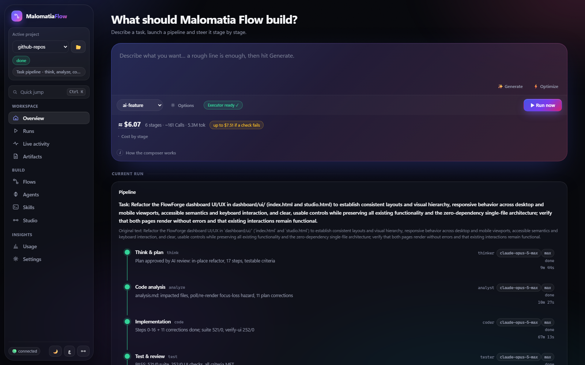
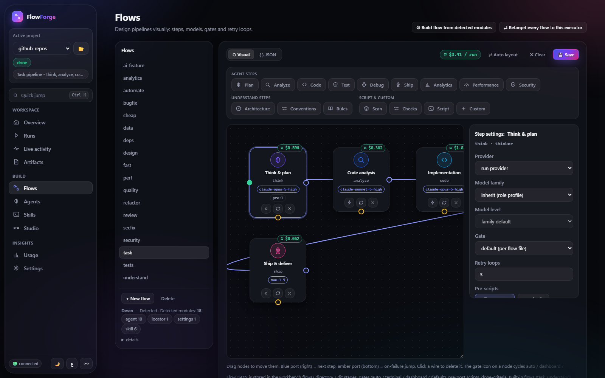
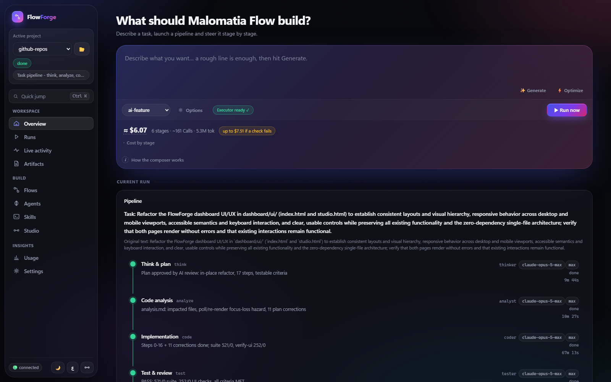
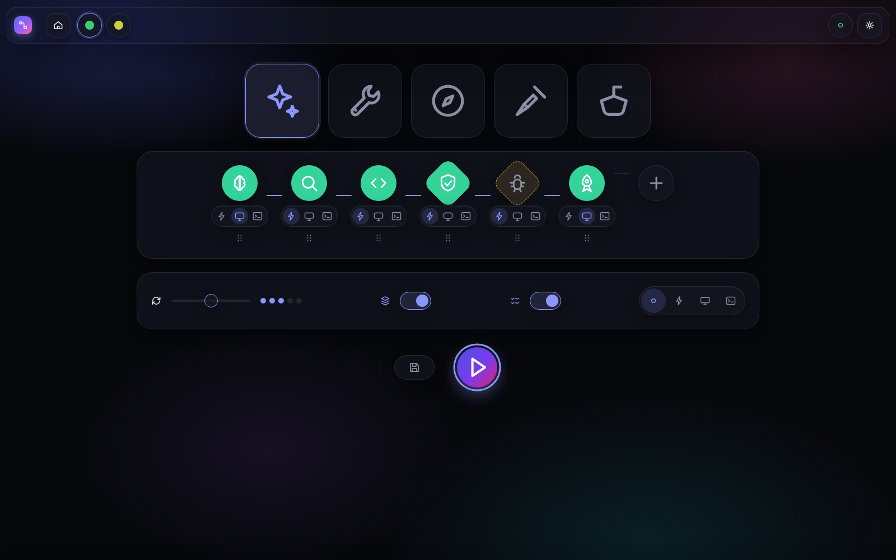

# Malomatia Flow

**Turn one sentence into a staged AI engineering pipeline — on any agent CLI.**

Malomatia Flow is a zero-dependency Node.js orchestrator that runs structured,
gated pipelines on top of whichever AI agent CLI you already have: Devin,
Claude Code, GitHub Copilot, Codex, Gemini, OpenCode, Augment or cursor-agent.
A live dashboard (pure Node, no npm packages) shows every stage, gate, artifact
and dollar as it happens — in English and Arabic.

```
mflow                  # open the dashboard
mflow run task "add input validation to /upload"   # or straight from a terminal
```

## Why Malomatia Flow

- **Runs on everything.** The dashboard is the orchestrator: it walks the flow
  and spawns one headless CLI call per stage (`claude -p`, `codex exec`,
  `gemini -p`, `copilot -p`, `opencode run`, `auggie --print`, `devin -p`).
  The agent never orchestrates itself — routing, loops and gates are plain
  code, which costs zero tokens.
- **Cheapest model per stage.** Pin `provider` + `model` on any stage. Put the
  analyst on Gemini Flash and the coder on Claude; the run composer estimates
  the cost *before* it starts.
- **Quality gates, not hope.** A stage must produce its named artifact and meet
  its done-criteria — verdict stages can send work back through a fix loop,
  and gates can ask a human, an AI reviewer, or just pass.
- **Fresh context per stage.** Every stage is a new CLI session that reads the
  previous artifacts — no growing transcript tax, no context drift.
- **Interactive too.** `/flow`, `/understand`, `/flow-resume` inside Devin —
  and `install.mjs` wires the same skills/commands into `~/.claude`,
  `~/.codex`, `~/.gemini`, Copilot prompts and OpenCode where they exist.

## Install

```bash
git clone <repo> && cd Malomatia-Flow
node install.mjs          # wires every detected agent CLI, links > copies
mflow doctor              # verifies every link, locator and flow file
```

Node 18+, no dependencies. On Windows links are junctions (no admin needed);
anything that can't be linked is copied and reported honestly by `mflow doctor`.

## The dashboard

`mflow` starts `http://127.0.0.1:4820` — pick a project, a flow, an executor
provider, and press **Run**. You get:

- the flow canvas with live stage status and artifacts as they land,
- a cost estimate before the run and a live usage meter during it,
- gates answered from the browser, the terminal, or by an AI reviewer,
- a board for running several projects in parallel plus a task queue,
- a visual Studio for authoring flows, agents and skills — bilingual UI.









## Flows

A flow is a JSON file in `flows/`: stages with an agent role, a prompt, a gate,
done-criteria, and optional retry loops (`onFail` + `maxLoops`). Presets ship
for `task`, `understand`, `review`, `security`, `analytics`, `data`, `design`
and more. Author your own in the Studio tab — canvas or JSON, your call.

Per-stage routing is one field away:

```json
{ "id": "think", "agent": "thinker", "provider": "gemini", "model": "gemini-2.5-flash" }
{ "id": "code",  "agent": "coder",   "provider": "claude", "model": "claude-sonnet-4-5" }
```

## CLI

| Command | What it does |
|---|---|
| `mflow` | start the dashboard |
| `mflow run <flow> "<task>" [--provider=X] [--size=tiny\|small\|full] [--speed=fast\|balanced\|quality]` | run headless |
| `mflow doctor [--fix]` | verify wiring, flows and the state engine |
| `mflow install` | (re)wire skills/agents/commands into every detected CLI |
| `mflow status` | install-state JSON |
| `mflow queue-wait` | consume the queued task (daemon mode) |

`flowforge` and `ff` keep working as aliases.

## Editing a flow mid-run?

The run pins the flow file's mtime at start. If the file changes mid-flight the
dashboard flags it — the run keeps applying the snapshot it started with, so
you always know which version produced which artifacts.

## License

MIT — malomatia digital transformation.
